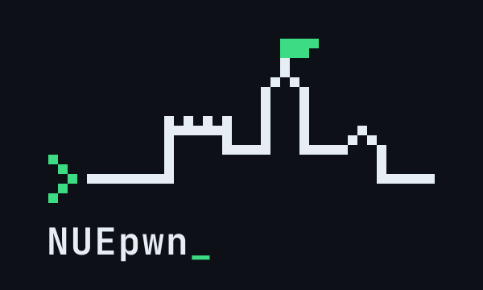

  <h3>Willkommen bei NUEpwn_</h3>
  

---

<h3>Übersicht</h1>
<ul>
  <li><a href="#about">Über uns</a></li>
  <li><a href="#members">Wer darf mitmachen?</a></li>
  <li><a href="#rules">Regeln</a></li>
  <li><a href="#contact">Kontakt</a></li>
  <li><a href="#faq">FAQ</a></li>
</ul>

<h3 id="about"><code>$ whoami</code></h1>

NUEpwn_ ist eine Gruppe von Leuten aus Nürnberg und Umgebung, die Spaß an IT-Sicherheit haben.
Bei **CTFs** (Capture the Flag) lösen Teams Hacking-Aufgaben, um versteckte „Flags“ zu finden:
Webseiten knacken, Binaries reversen, Kryptografie brechen, Spuren in Speicherabbildern suchen.
Wir spielen online bei internationalen CTFs mit, treffen uns aber auch gerne vor Ort in Nürnberg.
Nach jedem Event schreiben wir Writeups, damit alle etwas davon haben, auch wer gerade nicht dabei war.

---

<h3 id="members"><code>$ sudo -l #wer darf mitmachen?</code></h2>

Level 0: Noch nie einen CTF gespielt?

Perfekt. Du brauchst kein Vorwissen, nur Neugier. Wir zeigen dir die Tools, erklären die Grundlagen und lösen die ersten Aufgaben gemeinsam mit dir.

  
Level 1: Schon ein paar Flags gesammelt?

Dann spiel mit uns die nächsten Events, spezialisier dich auf eine Kategorie und teil dein Wissen in Writeups.

  
Level 1337: Alter Hase?

Großartig. Hilf uns, schwierige Challenges zu knacken, und nimm Neue mit. Erklären ist die beste Art, selbst noch besser zu werden.

---

<h3 id="rules"><code>$ rules.py</code></h2>

- [x] Es gibt keine dummen Fragen. Jede:r hat mal angefangen.
- [x] Reskeptvoller Umgang, egal wer du bist, woher du kommst oder was du kannst.
- [x] Wir hacken nur, was wir dürfen: CTF-Infrastruktur und eigene Testsysteme.
- [x] Während eines laufenden CTFs werden keine Lösungen nach außen geteilt.
- [x] Wir halten uns strikt an die [Hacker-Ethik](https://www.ccc.de/hackerethics).

---

<h3 id="contact"><code>$ ./join.sh</code></h2>

> [!warning]
> Unser Discord ist nur auf Einladung, damit dort keine Bots und Spammer landen. Schreib uns kurz, wer du bist, und du bekommst einen Invite.

<ul class="links">
  <li><a class="link" id="contact" href="#mitmachen" data-u="nuepwn" data-d="tuta.io" data-todo="kontakt">kontakt</a> Invite für den Discord anfragen</li>
  <li><a class="link" href="https://ctftime.org/team/453738" rel="noopener">ctftime</a> Unsere Platzierungen und kommende Events</li>
  <li><a class="link" href="https://github.com/NUEpwn" rel="noopener">github</a> Writeups, Tools und Code</li>
</ul>

---

<h3 id="faq"><code>man nuepwn</code></h2>

  
Was ist ein CTF?

Ein Capture-the-Flag ist ein Wettbewerb für IT-Sicherheit. Die Veranstalter bauen absichtlich verwundbare Programme, Webseiten oder Rätsel. Wer die Schwachstelle findet, bekommt eine „Flag“ (eine Zeichenkette wie flag{...}) und dafür Punkte. Die meisten CTFs laufen online über ein Wochenende.

  
Was muss ich mitrbingen?

Einen Laptop, Neugier und etwas Zeit. Linux-Kenntnisse helfen, sind aber kein Muss. Den Rest lernst du beim Spielen.

  
Kostet das etwas?

Nein. Die meisten CTFs sind kostenlos, und bei uns mitzumachen auch. Wenn es später einen Verein gibt, wird es dort eine Mitgliedschaft geben, aber mitspielen bleibt offen.

  
Muss ich in Nürnberg wohnen?

Nein. Wir spielen vor allem online. Unser Herz schlägt aber in Nürnberg, und Treffen vor Ort sind hier am einfachsten.

  
Ist das legal?

Ja. Bei CTFs greifen wir ausschließlich Systeme an, die genau dafür gebaut wurden und für die wir die Erlaubnis haben. Echte Systeme ohne Erlaubnis anzugreifen ist tabu. Siehe <a href="https://www.ccc.de/hackerethics">Hacker-Ethik</a>

---

  &copy; NUEpwn_ · CTF-Team aus Nürnberg · Verein in Vorbereitung

